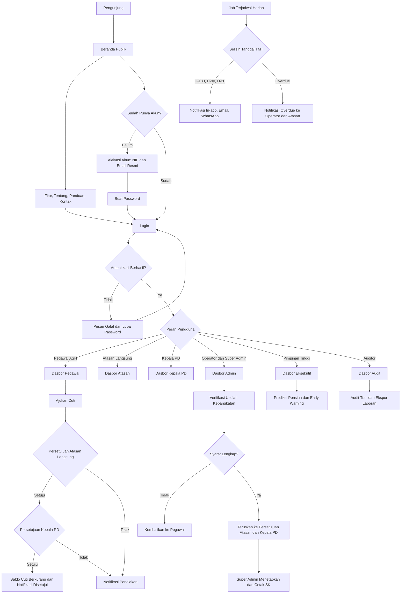

# SIMPEG Daerah

---

## 1. Ringkasan & Tujuan Aplikasi
*Bagian ini menjelaskan gambaran umum proyek agar dipahami bersama oleh pemilik ide/klien dan tim pengembang.*
- **Nama Aplikasi**: SIMPEG Daerah (Sistem Informasi Manajemen Kepegawaian Pemerintah Daerah)
- **Penjelasan Singkat**: Platform digital terintegrasi yang mengelola seluruh siklus hidup ASN di Pemerintah Daerah, mulai dari data induk, kenaikan pangkat, mutasi, kinerja, kehadiran, cuti, diklat, disiplin, hingga pensiun, dalam satu sistem yang prediktif dan self-service. Nilai pembedanya terletak pada notifikasi proaktif jauh hari sebelum event penting (H-180, H-90, H-30, dan overdue).
- **Masalah yang Diselesaikan**:
  - Data pegawai tidak real-time dan tersebar di banyak berkas.
  - Kenaikan pangkat sering terlambat karena perhitungan masa kerja dan kelengkapan syarat dilakukan secara manual.
  - Pengajuan cuti, mutasi, dan diklat masih menggunakan kertas dan tanda tangan fisik.
  - Pimpinan kesulitan memantau kondisi SDM secara menyeluruh dan real-time.
  - Pegawai harus datang ke BKPSDM untuk urusan administrasi sederhana.
  - Tidak ada peringatan dini untuk kepangkatan, KGB, pensiun, maupun masa berlaku hukuman disiplin.
  - Analisis formasi dan perencanaan suksesi sulit dilakukan karena data tidak terintegrasi.
- **Pengguna Aplikasi**:
  - **Super Admin / BKPSDM**: Kontrol penuh, konfigurasi aturan bisnis, dan manajemen pengguna.
  - **Operator Kepegawaian**: Input dan verifikasi data, memproses usulan, serta mengelola dokumen.
  - **Kepala Perangkat Daerah**: Memantau bawahan dan memberi persetujuan tingkat kedua.
  - **Atasan Langsung**: Memberi persetujuan tingkat pertama, penilaian SKP, dan memantau bawahan langsung.
  - **Pegawai ASN**: Mengakses data pribadi, mengajukan cuti, mengunggah dokumen, dan melihat prediksi kepangkatan.
  - **Pimpinan Tinggi**: Melihat dashboard eksekutif, prediksi pensiun, dan analisis formasi.
  - **Auditor / Inspektorat**: Akses baca saja dan penelusuran jejak audit.
- **Target Keberhasilan**:
  - Kenaikan pangkat tepat waktu meningkat secara signifikan dibandingkan kondisi awal.
  - Waktu penyelesaian usulan (cuti, mutasi, diklat) berkurang.
  - Adopsi self-service pegawai di atas 70 persen dalam enam bulan pertama.
  - Kunjungan fisik pegawai ke BKPSDM menurun.
  - Kepuasan pengguna dan ketersediaan data real-time meningkat.

---

## 2. Batasan Pembuatan Sistem (Versi Awal MVP)
*Menegaskan fitur apa yang dikerjakan di versi awal dan apa yang sengaja ditunda agar aplikasi cepat selesai dan tidak membengkak (mencegah scope creep).*

### ✅ Yang Dikerjakan:
- Autentikasi email dan password dengan aktivasi akun pegawai menggunakan NIP dan email resmi.
- Data Induk Pegawai: profil, riwayat jabatan dan golongan, dokumen digital, update mandiri dengan persetujuan atasan, dan QR Code identitas.
- Self-Service Portal Pegawai, mencakup profil pribadi, pengajuan cuti dengan sisa cuti real-time, riwayat kepangkatan dan prediksi naik pangkat, upload dan unduh dokumen, QR Code identitas, serta riwayat absensi.
- Kepangkatan: perhitungan prediksi otomatis berdasarkan aturan yang dapat dikonfigurasi, daftar akan naik pangkat, checklist syarat, workflow usulan, dan notifikasi bertingkat (H-180, H-90, H-30, overdue).
- Jabatan dan Mutasi: usulan mutasi, rotasi, dan promosi, pengelolaan formasi jabatan, serta lowongan internal sederhana.
- Penilaian Kinerja (SKP): penetapan target, monitoring realisasi, penilaian atasan, dan dashboard kinerja dasar.
- Kehadiran: rekap harian dan bulanan, deteksi keterlambatan, serta penerimaan data absensi melalui API ingest dan import CSV.
- Cuti dan Izin: pengajuan, sisa cuti real-time, dan persetujuan berjenjang Atasan Langsung lalu Kepala Perangkat Daerah.
- Diklat dan Kompetensi: riwayat diklat, usulan diklat, gap kompetensi berbasis aturan, dan rekomendasi diklat otomatis berbasis rule.
- Hukuman Disiplin: pencatatan, dampak ke pangkat dan jabatan, serta notifikasi masa berlaku.
- Pensiun dan Purna Tugas: prediksi tanggal pensiun, countdown, dan checklist dokumen.
- Dokumen Kepegawaian: manajemen digital, versioning, dan status persetujuan internal (bukan TTE tersertifikasi).
- Notifikasi In-app, Email, dan WhatsApp Gateway.
- Dashboard Eksekutif: prediksi pensiun, early warning kepangkatan, dan analisis formasi.
- Audit Trail dan Log Aktivitas (read-only untuk Auditor).
- Laporan standar dalam format tabel dan unduhan CSV serta PDF.
- Pengaturan Aturan Bisnis dan manajemen RBAC oleh Super Admin.
- Tampilan web responsif sempurna dan PWA-ready (dapat dipasang di layar utama ponsel).

### ⛔ Yang Tidak Dikerjakan di Versi Awal:
- Aplikasi native Android dan iOS (akan dikembangkan setelah MVP stabil).
- Notifikasi Push native mobile (menunggu aplikasi native).
- Integrasi otomatis dengan SIASN/BKN (disiapkan melalui arsitektur API-first, implementasi bertahap setelah MVP).
- Integrasi e-Kinerja, sistem gaji, dan pelaporan keuangan (hanya disiapkan melalui adapter dan kontrak API).
- TTE tersertifikasi BSrE (MVP hanya menyediakan status persetujuan internal).
- Pengenalan wajah (face recognition) dan integrasi langsung driver fingerprint (MVP menggunakan endpoint ingest dan import).
- Single Sign-On (SSO) lintas sistem (disiapkan sebagai fase lanjutan).
- Rekomendasi kompetensi berbasis kecerdasan buatan (MVP menggunakan aturan statis).
- Pengelolaan penggajian. SIMPEG Daerah tidak menggantikan sistem gaji secara penuh dan hanya dapat diintegrasikan.

---

## 3. Daftar Halaman & Struktur Menu (Pages & Routing)
*Daftar lengkap halaman yang harus dibuat, dikelompokkan berdasarkan area atau peran pengguna (Role).*

### A. Public Area (Tanpa Login)
- `/` (Beranda): Hero section, ringkasan manfaat SIMPEG Daerah, statistik ilustratif, dan CTA login.
- `/tentang` (Tentang Kami): Visi, misi, tujuan, dan ruang lingkup modul.
- `/fitur` (Fitur Unggulan): Penjelasan modul inti dengan ilustrasi dan kartu interaktif.
- `/panduan` (Panduan Pengguna): Panduan singkat per peran, dilengkapi accordion FAQ.
- `/kontak` (Kontak BKPSDM): Formulir pengaduan dan informasi layanan dengan dummy data.
- `/verifikasi/[token]` (Verifikasi QR Code): Halaman publik yang menampilkan status aktif pegawai (nama, NIP tersamar, PD, dan status) tanpa menampilkan data sensitif.
- `/login` (Masuk): Form email dan password, tautan lupa password, dan tautan aktivasi akun.
- `/aktivasi` (Aktivasi Akun Pegawai): Verifikasi NIP dan email resmi, lalu pembuatan password.
- `/lupa-password` (Lupa Password): Permintaan tautan reset melalui email.
- `/reset-password` (Reset Password): Form password baru dengan indikator kekuatan password.
- `/kebijakan-privasi` (Kebijakan Privasi): Pemenuhan prinsip UU Pelindungan Data Pribadi.
- `/syarat-ketentuan` (Syarat dan Ketentuan): Ketentuan penggunaan layanan.

### B. Pegawai ASN (Self-Service, Setelah Login)
- `/dashboard` (Dasbor Pegawai): Ringkasan sisa cuti, status usulan aktif, countdown kenaikan pangkat berikutnya, dan notifikasi terbaru.
- `/pegawai/profil` (Profil Saya): Data pribadi dan kepegawaian dengan form update mandiri yang memerlukan persetujuan.
- `/pegawai/profil/riwayat-perubahan` (Riwayat Perubahan Data): Status pengajuan perubahan data.
- `/pegawai/cuti` (Cuti Saya): Daftar pengajuan, sisa cuti real-time, dan tombol ajukan cuti.
- `/pegawai/cuti/baru` (Ajukan Cuti): Form pengajuan cuti dengan kalkulasi hari otomatis.
- `/pegawai/kepangkatan` (Kepangkatan Saya): Riwayat golongan, prediksi naik pangkat, dan checklist syarat.
- `/pegawai/dokumen` (Dokumen Saya): Daftar dokumen digital, unggah, unduh, dan riwayat versi.
- `/pegawai/qr` (QR Identitas): Kartu identitas digital dengan QR Code dan opsi unduh.
- `/pegawai/absensi` (Riwayat Absensi): Kalender kehadiran, rekap bulanan, dan keterlambatan.
- `/pegawai/diklat` (Diklat Saya): Riwayat diklat, usulan diklat, dan rekomendasi kompetensi.
- `/pegawai/kinerja` (SKP Saya): Target SKP, realisasi, dan nilai penilaian atasan.
- `/pegawai/disiplin` (Riwayat Disiplin): Catatan hukuman disiplin yang berlaku beserta masa berlakunya.
- `/pegawai/pensiun` (Persiapan Pensiun): Countdown pensiun dan checklist dokumen.
- `/pegawai/notifikasi` (Notifikasi): Daftar notifikasi in-app dengan filter kategori.
- `/pegawai/pengaturan` (Pengaturan Akun): Ganti password, preferensi notifikasi WhatsApp dan email.

### C. Atasan Langsung (Setelah Login)
- `/atasan/dashboard` (Dasbor Atasan): Ringkasan bawahan, antrean persetujuan, dan bawahan yang akan naik pangkat.
- `/atasan/persetujuan` (Antrean Persetujuan): Daftar cuti, usulan mutasi, dan usulan diklat dengan aksi setujui atau tolak.
- `/atasan/persetujuan/[id]` (Detail Persetujuan): Detail usulan, riwayat workflow, dan kolom catatan.
- `/atasan/bawahan` (Daftar Bawahan): Tabel bawahan dengan status dan indikator kinerja.
- `/atasan/bawahan/[id]` (Profil Bawahan Ringkas): Ringkasan data, SKP, cuti, dan absensi bawahan.
- `/atasan/penilaian` (Penilaian SKP): Daftar SKP bawahan untuk dinilai.
- `/atasan/penilaian/[id]` (Form Penilaian SKP): Form penilaian dengan kalkulasi nilai otomatis.

### D. Kepala Perangkat Daerah (Setelah Login)
- `/kepala-pd/dashboard` (Dasbor Kepala PD): Ringkasan seluruh pegawai dalam PD dan KPI kehadiran serta kinerja.
- `/kepala-pd/persetujuan` (Persetujuan Tingkat Kedua): Usulan yang telah disetujui Atasan Langsung dan menunggu keputusan Kepala PD.
- `/kepala-pd/monitoring` (Monitoring Pegawai): Peta jabatan, distribusi golongan, dan daftar pegawai akan pensiun di PD.
- `/kepala-pd/formasi` (Formasi PD): Kebutuhan dan ketersediaan formasi jabatan di PD.

### E. Operator Kepegawaian & Super Admin (Setelah Login)
- `/admin/dashboard` (Dasbor Admin): KPI kepegawaian, antrean verifikasi, dan peringatan sistem.
- `/admin/pegawai` (Data Induk Pegawai): Tabel pegawai dengan pencarian, filter, dan pagination server-side.
- `/admin/pegawai/baru` (Tambah Pegawai): Form data induk lengkap dengan validasi.
- `/admin/pegawai/[id]` (Detail Pegawai): Profil lengkap dengan tab riwayat, dokumen, cuti, kinerja, dan disiplin.
- `/admin/pegawai/[id]/edit` (Edit Pegawai): Form edit dengan pencatatan audit.
- `/admin/pegawai/impor` (Impor Pegawai): Unggah CSV, pratinjau data, validasi baris, dan laporan kesalahan.
- `/admin/perubahan-data` (Verifikasi Perubahan Data): Antrean update mandiri pegawai untuk diverifikasi.
- `/admin/kepangkatan` (Manajemen Kepangkatan): Daftar prediksi dan usulan kenaikan pangkat.
- `/admin/kepangkatan/[id]` (Detail Usulan Pangkat): Checklist syarat, berkas, dan workflow.
- `/admin/kepangkatan/aturan` (Aturan Masa Kerja): Konfigurasi masa kerja per golongan.
- `/admin/jabatan-mutasi` (Jabatan dan Mutasi): Daftar usulan mutasi, rotasi, dan promosi.
- `/admin/jabatan-mutasi/baru` (Usulan Mutasi Baru): Form usulan mutasi.
- `/admin/jabatan` (Master Jabatan): CRUD jabatan dan struktur organisasi.
- `/admin/lowongan` (Lowongan Internal): Pengelolaan lowongan jabatan dan pendaftar.
- `/admin/kinerja` (Manajemen SKP): Pengelolaan SKP seluruh pegawai dan monitoring tahun berjalan.
- `/admin/absensi` (Kehadiran dan Absensi): Rekap, filter keterlambatan, dan impor data absensi.
- `/admin/absensi/perangkat` (Perangkat Absensi): Daftar perangkat, status koneksi, dan kunci API.
- `/admin/cuti` (Manajemen Cuti): Daftar pengajuan cuti seluruh pegawai dan pengaturan jatah.
- `/admin/diklat` (Master Diklat): CRUD katalog diklat.
- `/admin/diklat/usulan` (Usulan Diklat): Antrean usulan diklat dan rekomendasi otomatis.
- `/admin/kompetensi` (Kompetensi dan Gap): Master kompetensi dan analisis gap per jabatan.
- `/admin/disiplin` (Hukuman Disiplin): Pencatatan, dampak pangkat dan jabatan, serta status masa berlaku.
- `/admin/pensiun` (Pensiun dan Purna Tugas): Daftar pegawai akan pensiun, countdown, dan checklist.
- `/admin/dokumen` (Dokumen Kepegawaian): Pengelolaan dokumen seluruh pegawai dengan filter kategori.
- `/admin/dokumen/[id]` (Detail Dokumen): Pratinjau, riwayat versi, dan status persetujuan.
- `/admin/formasi` (Formasi dan Analisis Kebutuhan): Perencanaan formasi per PD dan tahun.
- `/admin/talent-pool` (Talent Pool dan Suksesi): Daftar kandidat talenta dan kesiapan suksesi.
- `/admin/notifikasi` (Pusat Notifikasi): Konfigurasi template notifikasi dan log pengiriman.
- `/admin/notifikasi/template` (Template Pesan): Editor template WhatsApp dan email dengan variabel dinamis.
- `/admin/laporan` (Laporan): Generator laporan standar dengan filter dan ekspor CSV atau PDF.
- `/admin/aturan-bisnis` (Pengaturan Aturan Bisnis): Konfigurasi usia pensiun, jatah cuti, ambang keterlambatan, dan masa berlaku disiplin.
- `/admin/pengguna` (Manajemen Pengguna dan Peran): Undang akun, atur peran (RBAC), dan nonaktifkan akun.
- `/admin/pengaturan` (Pengaturan Umum): Profil instansi, logo, zona waktu, dan integrasi pihak ketiga.

### F. Pimpinan Tinggi (Setelah Login, Read-Only)
- `/eksekutif/dashboard` (Dasbor Eksekutif): KPI strategis, grafik kepegawaian, dan peringatan dini.
- `/eksekutif/pensiun` (Prediksi Pensiun): Proyeksi pensiun per tahun, PD, dan jabatan.
- `/eksekutif/early-warning` (Early Warning Kepangkatan): Daftar pegawai yang berpotensi terlambat naik pangkat.
- `/eksekutif/formasi` (Analisis Formasi): Analisis kebutuhan jabatan dan rasio pegawai.
- `/eksekutif/laporan` (Laporan Strategis): Laporan terkurasi dengan unduhan PDF.

### G. Auditor / Inspektorat (Setelah Login, Read-Only)
- `/audit/dashboard` (Dasbor Audit): Ringkasan aktivitas dan anomali.
- `/audit/trail` (Audit Trail): Jejak perubahan data dengan sebelum dan sesudah, filter aktor, tanggal, dan entitas.
- `/audit/log` (Log Aktivitas Login): Riwayat login, kegagalan login, dan alamat IP.
- `/audit/laporan` (Laporan Audit): Ekspor laporan audit untuk pemeriksaan.

---

## 4. Pedoman UI/UX & Design System
*Panduan visual konkret agar AI coding assistant tidak membuat UI yang kaku atau default.*
- **Skema Warna**:
  - Primary (Biru Indigo): HSL(224, 76%, 48%), digunakan untuk tombol utama, tautan aktif, dan highlight sidebar.
  - Primary Hover: HSL(224, 76%, 40%).
  - Secondary (Biru Muda Lembut): HSL(214, 95%, 96%), digunakan untuk latar kartu info dan badge netral.
  - Accent (Indigo): HSL(239, 84%, 67%), digunakan untuk grafik sekunder dan ikon aksen.
  - Background: HSL(220, 20%, 98%) pada mode terang, dengan kartu berwarna HSL(0, 0%, 100%).
  - Foreground Teks: HSL(222, 47%, 11%).
  - Muted Text: HSL(215, 16%, 47%).
  - Border: HSL(214, 32%, 91%).
  - Success: HSL(142, 71%, 35%), Warning: HSL(38, 92%, 45%), Danger: HSL(0, 72%, 51%), Info: HSL(199, 89%, 42%).
  - Mode gelap didukung melalui CSS variable shadcn/ui dengan Background HSL(222, 47%, 7%) dan Primary HSL(224, 76%, 60%).
- **Tipografi**:
  - Heading menggunakan font 'Plus Jakarta Sans' dengan bobot 600 sampai 800.
  - Body dan antarmuka menggunakan font 'Inter' dengan bobot 400 dan 500.
  - Ukuran dasar teks 14 pixel untuk tabel dan 16 pixel untuk paragraf.
  - Angka statistik menggunakan `tabular-nums` agar kolom angka sejajar.
- **Aturan Komponen**:
  - Semua komponen menggunakan shadcn/ui dengan kustomisasi melalui CSS variable.
  - Sudut membulat `rounded-xl` untuk kartu dan `rounded-lg` untuk input serta tombol.
  - Kartu biasa menggunakan `shadow-sm` dan border tipis. Saat hover kartu interaktif menggunakan `shadow-lg` dengan transisi 200 milidetik.
  - Tabel data menggunakan header sticky, zebra striping halus, pagination server-side, dan aksi kontekstual melalui dropdown.
  - Badge status wajib konsisten lintas modul:
    - Diajukan: biru.
    - Disetujui: hijau.
    - Ditolak: merah.
    - Menunggu: kuning.
    - Draf: abu-abu.
    - Selesai: indigo.
  - Modal dan Sheet untuk form cepat. Halaman penuh untuk form kompleks seperti tambah pegawai.
  - Notifikasi pengguna menggunakan Toast (Sonner) dengan posisi kanan atas.
  - Ikon menggunakan Lucide Icons secara konsisten dengan ukuran 16 hingga 20 pixel.
  - Skeleton loader untuk setiap tabel dan kartu saat data dimuat.
- **Responsivitas**:
  - Desktop (lebar lebih dari 1024 piksel): sidebar tetap di kiri dengan lebar 260 piksel.
  - Tablet (768 hingga 1024 piksel): sidebar dapat diciutkan menjadi ikon.
  - Mobile (kurang dari 768 piksel): sidebar berubah menjadi drawer, tabel berubah menjadi kartu daftar, dan tombol aksi utama berada di bawah layar.
- **Nuansa & Vibe**: Clean, modern, profesional, dan terasa seperti produk SaaS modern. Mengutamakan whitespace yang lapang, hierarki visual yang jelas, serta micro-animations halus (fade-in, slide-in, dan animasi angka pada statistik). Antarmuka tidak boleh terasa kaku seperti sistem lama pemerintahan.
- **Standard Eduwebmu Design**: Konsistensi mengikuti standar Eduwebmu, yaitu kartu bersih, sidebar biru gelap atau putih dengan highlight indigo, dan tipografi yang tegas.
- **Aksesibilitas**: Kontras teks minimal WCAG AA, fokus keyboard yang terlihat, label form yang eksplisit, dan teks alternatif pada seluruh ikon bermakna.

---

## 5. Pembagian Hak Akses Pengguna
*Tabel hak akses yang menentukan siapa saja yang boleh melihat, mengedit, atau mengelola data.*

| Menu / Halaman | Publik (Tanpa Login) | Pegawai ASN | Atasan Langsung | Kepala PD | Operator Kepegawaian | Super Admin | Pimpinan Tinggi | Auditor / Inspektorat |
| :--- | :---: | :---: | :---: | :---: | :---: | :---: | :---: | :---: |
| Beranda, Tentang, Fitur, Kontak | ✅ | ✅ | ✅ | ✅ | ✅ | ✅ | ✅ | ✅ |
| Verifikasi QR Code (Data Terbatas) | ✅ | ✅ | ✅ | ✅ | ✅ | ✅ | ✅ | ✅ |
| Profil, Cuti, Dokumen, Absensi Diri Sendiri | ❌ | ✅ | ✅ | ✅ | ✅ | ✅ | ❌ | ❌ |
| Persetujuan Cuti dan Usulan Bawahan | ❌ | ❌ | ✅ | ✅ | ❌ | ✅ | ❌ | ❌ |
| Persetujuan Tingkat Kedua | ❌ | ❌ | ❌ | ✅ | ❌ | ✅ | ❌ | ❌ |
| Data Induk Pegawai (Tambah dan Edit) | ❌ | ❌ | ❌ | ❌ | ✅ | ✅ | ❌ | ❌ |
| Data Induk Pegawai (Lihat Semua) | ❌ | ❌ | ❌ | Lingkup PD | ✅ | ✅ | ❌ | ✅ |
| Manajemen Kepangkatan | ❌ | ❌ | ❌ | ❌ | ✅ | ✅ | ❌ | Lihat |
| Jabatan dan Mutasi | ❌ | ❌ | ❌ | Lingkup PD | ✅ | ✅ | ❌ | Lihat |
| SKP dan Penilaian | ❌ | Diri sendiri | Bawahan | Lingkup PD | Lihat | ✅ | Agregat | Lihat |
| Kehadiran dan Absensi | ❌ | Diri sendiri | Bawahan | Lingkup PD | ✅ | ✅ | Agregat | Lihat |
| Cuti dan Izin | ❌ | Diri sendiri | Bawahan | Lingkup PD | ✅ | ✅ | ❌ | Lihat |
| Diklat dan Kompetensi | ❌ | Diri sendiri | Bawahan | Lingkup PD | ✅ | ✅ | Agregat | Lihat |
| Hukuman Disiplin | ❌ | Diri sendiri | ❌ | Lingkup PD | ✅ | ✅ | Agregat | Lihat |
| Pensiun dan Purna Tugas | ❌ | Diri sendiri | ❌ | Lingkup PD | ✅ | ✅ | ✅ | Lihat |
| Dokumen Kepegawaian | ❌ | Diri sendiri | Bawahan (Lihat) | Lingkup PD | ✅ | ✅ | ❌ | Lihat |
| Formasi dan Analisis Kebutuhan | ❌ | ❌ | ❌ | Lingkup PD | ✅ | ✅ | ✅ | Lihat |
| Talent Pool dan Suksesi | ❌ | ❌ | ❌ | Lingkup PD | ✅ | ✅ | ✅ | ❌ |
| Dashboard Eksekutif dan Early Warning | ❌ | ❌ | ❌ | Lingkup PD | ❌ | ✅ | ✅ | Lihat |
| Audit Trail dan Log Aktivitas | ❌ | ❌ | ❌ | ❌ | ❌ | ✅ | ❌ | ✅ |
| Laporan | ❌ | ❌ | ❌ | Lingkup PD | ✅ | ✅ | Strategis | ✅ |
| Pengaturan Aturan Bisnis | ❌ | ❌ | ❌ | ❌ | ❌ | ✅ | ❌ | ❌ |
| Manajemen Pengguna dan Peran | ❌ | ❌ | ❌ | ❌ | ❌ | ✅ | ❌ | ❌ |

*Keterangan: "Lingkup PD" berarti hanya data pegawai di Perangkat Daerah tempat pengguna bertugas. "Bawahan" berarti hanya pegawai yang atasan_id-nya mengarah ke pengguna. "Agregat" berarti hanya ringkasan tanpa data pribadi individu. "Lihat" berarti akses baca saja.*

---

## 6. Alur Kerja dan Fitur Utama
*Menjelaskan cara kerja setiap fitur utama dalam bahasa yang mudah dipahami serta aturan logikanya.*

### A. Data Induk Pegawai
1. **Cara Kerja**:
   - Operator menambahkan pegawai baru melalui form atau impor CSV.
   - Sistem membuat data induk, lalu mengirimkan undangan aktivasi ke email resmi pegawai.
   - Pegawai mengaktifkan akun melalui `/aktivasi` dengan memasukkan NIP dan kode verifikasi.
   - Pegawai dapat mengajukan perubahan data pribadi melalui `/pegawai/profil`. Perubahan tidak langsung tersimpan, melainkan masuk antrean verifikasi Operator setelah disetujui Atasan Langsung.
   - Setiap pegawai memiliki QR Code unik yang dapat dipindai untuk verifikasi status aktif.
2. **Aturan Sistem**:
   - NIP wajib 18 digit numerik dan unik.
   - NIK disimpan dalam bentuk tersamar (contoh: `3201********0001`). Nilai lengkap dienkripsi dan hanya dapat dilihat oleh Super Admin dengan pencatatan audit.
   - Foto profil maksimal 2 MB dengan format JPG atau PNG.
   - Perubahan data sensitif (nama, tanggal lahir, golongan, jabatan) wajib melalui workflow persetujuan.
   - Setiap perubahan dicatat pada `audit_log`.

### B. Kepangkatan (Prediksi, Checklist, dan Notifikasi Bertingkat)
1. **Cara Kerja**:
   - Sistem menghitung tanggal kenaikan pangkat berikutnya berdasarkan TMT golongan terakhir dan masa kerja yang dikonfigurasi di `aturan_kepangkatan`.
   - Setiap malam, job terjadwal menghitung ulang seluruh prediksi dan memperbarui status (Akan Datang, Siap Diusulkan, Overdue).
   - Operator membuka daftar akan naik pangkat, memilih pegawai, lalu memeriksa checklist syarat (SKP minimal baik, diklat, disiplin tidak aktif, dan dokumen lengkap).
   - Usulan dibuat dan diajukan melalui workflow: Operator memverifikasi, lalu Kepala PD menyetujui, dan terakhir Super Admin menetapkan.
   - Pegawai melihat countdown dan checklist di `/pegawai/kepangkatan`.
2. **Aturan Sistem**:
   - Notifikasi bertingkat dikirim pada H-180, H-90, H-30, dan overdue (setelah tanggal TMT terlampaui tanpa usulan).
   - Setiap notifikasi dikirim melalui tiga kanal: In-app, Email, dan WhatsApp Gateway sesuai preferensi pegawai.
   - Pegawai yang memiliki hukuman disiplin aktif tingkat sedang atau berat otomatis ditandai "Tertunda" dan tidak dapat diusulkan hingga masa berlaku berakhir.
   - Early warning ditandai merah jika prediksi terlambat lebih dari 30 hari dari TMT yang seharusnya.
   - Aturan masa kerja (contoh standar 4 tahun untuk kenaikan reguler) dapat diubah Super Admin tanpa perubahan kode, dengan pencatatan versi aturan.

### C. Jabatan dan Mutasi (Mutasi, Rotasi, Promosi, dan Formasi)
1. **Cara Kerja**:
   - Operator atau Kepala PD membuat usulan mutasi dengan memilih pegawai, PD asal, PD tujuan, dan jabatan tujuan.
   - Sistem memeriksa ketersediaan formasi pada jabatan tujuan.
   - Usulan melalui workflow Atasan Langsung lalu Kepala PD, kemudian Operator memproses SK.
   - Lowongan internal diumumkan pada `/admin/lowongan` dan dapat dilamar oleh pegawai melalui portal.
2. **Aturan Sistem**:
   - Mutasi ke jabatan dengan formasi penuh ditolak otomatis kecuali Super Admin memberi override dengan alasan tertulis.
   - Promosi wajib memenuhi syarat kompetensi minimum yang ditetapkan pada master jabatan.
   - Setiap mutasi yang disetujui memperbarui `pd_id` dan `jabatan_id` pegawai serta tercatat pada riwayat.

### D. Penilaian Kinerja (SKP)
1. **Cara Kerja**:
   - Di awal tahun, pegawai dan atasan menetapkan SKP dengan menambahkan target kuantitas, kualitas, waktu, dan biaya.
   - Pegawai memperbarui realisasi per periode (bulanan atau triwulanan).
   - Atasan memberi penilaian akhir pada akhir periode, dan sistem menghitung nilai rata-rata serta predikat secara otomatis.
   - Dashboard kinerja menampilkan tren nilai per unit dan distribusi predikat.
2. **Aturan Sistem**:
   - Total bobot target SKP wajib 100 persen sebelum SKP dapat ditetapkan.
   - Nilai akhir dihitung berdasarkan rumus yang dapat dikonfigurasi, dengan nilai default rata-rata tertimbang aspek.
   - Predikat: 91 hingga 100 (Sangat Baik), 76 hingga 90 (Baik), 61 hingga 75 (Cukup), 51 hingga 60 (Kurang), kurang dari 51 (Sangat Kurang).
   - Penilaian yang sudah difinalisasi tidak dapat diubah kecuali dibuka kembali oleh Super Admin dengan alasan.

### E. Kehadiran dan Absensi
1. **Cara Kerja**:
   - Data absensi masuk melalui endpoint `/api/v1/absensi/ingest` dari perangkat fingerprint atau aplikasi absensi, atau melalui impor CSV oleh Operator.
   - Sistem mencocokkan data dengan NIP atau `device_user_id` pegawai, lalu menentukan status hadir, terlambat, atau alpha.
   - Pegawai melihat riwayat dan rekap pada `/pegawai/absensi`.
   - Atasan melihat ringkasan keterlambatan bawahan.
2. **Aturan Sistem**:
   - Setiap permintaan ingest wajib membawa header `X-Ingest-Signature` berbasis HMAC dan secret `ATTENDANCE_INGEST_SECRET`.
   - Ambang keterlambatan default pukul 07.30 WIB, dapat dikonfigurasi per PD.
   - Pegawai yang sedang cuti atau izin yang disetujui otomatis berstatus cuti atau izin, bukan alpha.
   - Data duplikat pada pasangan pegawai dan waktu yang sama diabaikan dan dicatat pada log.

### F. Cuti dan Izin
1. **Cara Kerja**:
   - Pegawai membuka `/pegawai/cuti/baru`, memilih jenis cuti, tanggal mulai, dan tanggal selesai.
   - Sistem menghitung jumlah hari kerja otomatis (mengecualikan Sabtu, Minggu, dan hari libur nasional) dan menampilkan sisa cuti real-time.
   - Pengajuan masuk ke Atasan Langsung, lalu setelah disetujui diteruskan ke Kepala PD.
   - Setelah disetujui penuh, saldo cuti berkurang dan status berubah menjadi Disetujui.
   - Pegawai dapat membatalkan pengajuan selama belum disetujui.
2. **Aturan Sistem**:
   - Cuti tahunan maksimal 12 hari kerja per tahun dan dapat dikonfigurasi.
   - Pengajuan cuti tahunan wajib diajukan minimal 3 hari kerja sebelum tanggal mulai.
   - Cuti sakit lebih dari 2 hari wajib melampirkan surat keterangan dokter.
   - Pengajuan yang tumpang tindih dengan cuti yang sudah disetujui ditolak otomatis.
   - Pengajuan yang ditolak Atasan Langsung tidak diteruskan ke Kepala PD.

### G. Diklat dan Kompetensi
1. **Cara Kerja**:
   - Admin mengelola katalog diklat (nama, jenis, penyelenggara, jam, dan kompetensi terkait).
   - Sistem membandingkan kompetensi yang dimiliki pegawai dengan standar kompetensi jabatan, lalu menampilkan gap.
   - Berdasarkan gap, sistem menghasilkan rekomendasi diklat otomatis.
   - Pegawai atau atasan mengusulkan diklat. Usulan disetujui berjenjang dan setelah selesai, sertifikat diunggah ke Supabase Storage.
2. **Aturan Sistem**:
   - Rekomendasi diklat berbasis aturan: jika level kompetensi kurang dari standar jabatan, diklat terkait direkomendasikan.
   - Sertifikat wajib berformat PDF, maksimal 5 MB.
   - Riwayat diklat yang sudah selesai otomatis memperbarui level kompetensi pegawai jika diklat memiliki kompetensi terkait.

### H. Hukuman Disiplin
1. **Cara Kerja**:
   - Operator atau Super Admin mencatat hukuman disiplin beserta jenis, pasal, tanggal keputusan, dan dokumen SK.
   - Sistem menentukan dampak otomatis: tunda kenaikan pangkat, tunda kenaikan gaji berkala, atau pemblokiran usulan jabatan sesuai aturan yang dikonfigurasi.
   - Notifikasi dikirim kepada pegawai, atasan, dan Operator.
   - Setelah masa berlaku berakhir, status otomatis menjadi Tidak Aktif.
2. **Aturan Sistem**:
   - Jenis hukuman: ringan, sedang, dan berat.
   - Masa berlaku default: ringan 12 bulan, sedang 24 bulan, berat 36 bulan (dapat dikonfigurasi).
   - Data disiplin hanya dapat dilihat oleh pegawai bersangkutan (diri sendiri), Operator, Super Admin, dan Auditor.

### I. Pensiun dan Purna Tugas
1. **Cara Kerja**:
   - Sistem menghitung tanggal pensiun berdasarkan tanggal lahir dan batas usia pensiun yang dikonfigurasi (default 58 tahun untuk PNS non-jabatan tertentu).
   - Pegawai dan Operator melihat countdown pada dashboard masing-masing.
   - Checklist dokumen pensiun (KTP, KK, SK terakhir, surat keterangan bebas hutang, dan lainnya) dikelola per pegawai.
   - Notifikasi bertingkat dikirim pada H-365, H-180, dan H-30.
2. **Aturan Sistem**:
   - Tanggal pensiun dihitung pada tanggal 1 bulan berikutnya setelah pegawai mencapai batas usia.
   - Pegawai yang akan pensiun dalam 12 bulan otomatis masuk Talent Pool sebagai indikator suksesi jika jabatan strategis.
   - Prediksi pensiun per PD tampil pada dashboard eksekutif dan Kepala PD.

### J. Dokumen Kepegawaian
1. **Cara Kerja**:
   - Pegawai atau Operator mengunggah dokumen ke kategori yang tersedia (SK, ijazah, KTP, sertifikat, surat cuti, dan lainnya).
   - Setiap unggahan baru pada dokumen yang sama membuat versi baru, dan versi lama tetap tersimpan.
   - Dokumen dapat diberi status persetujuan internal (Menunggu, Disetujui, Ditolak) oleh Operator.
   - Pegawai dapat mengunduh dokumen melalui tautan bertanda tangan (signed URL) dengan masa berlaku singkat.
2. **Aturan Sistem**:
   - Format yang diizinkan: PDF, JPG, dan PNG dengan ukuran maksimal 10 MB.
   - Dokumen bersifat privat pada Supabase Storage dan hanya diakses melalui signed URL berumur 300 detik.
   - Setiap pengunduhan dan unggahan dicatat pada `audit_log`.
   - Integrasi TTE tersertifikasi disiapkan melalui kolom `ttd_status` untuk tahap lanjutan.

### K. Self-Service Portal
1. **Cara Kerja**:
   - Pegawai masuk dan langsung melihat dashboard yang berisi ringkasan kebutuhan harian.
   - Seluruh layanan utama tersedia tanpa perlu datang ke BKPSDM: pengajuan cuti, unduh dokumen, cek kepangkatan, dan cetak QR Code.
   - Setiap status usulan dapat dipantau secara real-time pada menu notifikasi.
2. **Aturan Sistem**:
   - Pegawai hanya dapat melihat dan mengubah data miliknya sendiri, yang dijamin oleh Row Level Security.
   - Adopsi self-service dicatat melalui event analytics sederhana (jumlah layanan digunakan per bulan).

### L. Dashboard Eksekutif dan Analitik
1. **Cara Kerja**:
   - Pimpinan Tinggi membuka dashboard yang berisi KPI strategis, grafik prediksi pensiun, daftar early warning kepangkatan, dan analisis formasi.
   - Setiap kartu bersifat actionable: klik kartu membuka daftar detail yang relevan.
   - Filter tahun, PD, dan jenis pegawai tersedia pada seluruh grafik.
2. **Aturan Sistem**:
   - Data pada dashboard eksekutif berasal dari vista agregat yang diperbarui melalui job terjadwal setiap satu jam.
   - Pimpinan Tinggi tidak dapat melihat data individual pegawai, kecuali daftar early warning yang hanya menampilkan nama, jabatan, dan prediksi.

### M. Formasi dan Analisis Kebutuhan
1. **Cara Kerja**:
   - Operator menyusun formasi per PD, jabatan, dan tahun dengan kebutuhan dan kapasitas yang tersedia.
   - Sistem menghitung selisih (kekurangan atau kelebihan) dan menampilkan rasio pegawai per jabatan.
   - Analisis dapat diunduh sebagai laporan dan digunakan sebagai dasar usulan formasi.
2. **Aturan Sistem**:
   - Kebutuhan formasi tidak boleh negatif.
   - Perubahan formasi tahun berjalan wajib melalui persetujuan Super Admin.

### N. Talent Pool dan Suksesi
1. **Cara Kerja**:
   - Operator memasukkan kandidat talenta ke Talent Pool dengan jabatan target dan tingkat kesiapan (Siap Sekarang, Siap 1 sampai 2 Tahun, Siap 3 sampai 5 Tahun).
   - Sistem menampilkan peta suksesi per jabatan strategis.
2. **Aturan Sistem**:
   - Kandidat yang masuk Talent Pool wajib memiliki nilai SKP minimal Baik pada dua tahun terakhir secara otomatis sebagai syarat masuk.

### O. Notifikasi Multi-channel
1. **Cara Kerja**:
   - Setiap peristiwa penting (pengajuan, persetujuan, penolakan, pengingat kepangkatan, pengingat pensiun) memicu notifikasi.
   - Notifikasi dikirim melalui In-app, Email, dan WhatsApp Gateway sesuai preferensi pengguna.
   - Pegawai dapat mengatur kanal yang diaktifkan pada `/pegawai/pengaturan`.
2. **Aturan Sistem**:
   - Pesan WhatsApp menggunakan template yang disetujui penyedia gateway dan dikelola pada `/admin/notifikasi/template`.
   - Pesan yang gagal dikirim akan dicoba ulang maksimal tiga kali dengan jeda eksponensial dan dicatat pada `notifikasi_log`.
   - Nomor WhatsApp wajib menggunakan format 62 dan divalidasi.
   - Notifikasi tidak mengandung data sensitif seperti NIK atau nilai disiplin secara lengkap.

### P. Audit Trail dan Log Aktivitas
1. **Cara Kerja**:
   - Setiap perubahan data (tambah, ubah, hapus, persetujuan) dicatat dengan nilai sebelum dan sesudah.
   - Auditor memfilter data berdasarkan aktor, tanggal, entitas, dan jenis aksi, lalu mengekspor laporan.
   - Log login mencatat keberhasilan dan kegagalan login beserta alamat IP serta perangkat.
2. **Aturan Sistem**:
   - Tabel `audit_log` bersifat append-only. Tidak ada peran yang dapat mengubah atau menghapus log.
   - Retensi audit log minimal 5 tahun.
   - Auditor hanya memiliki akses baca.

### Q. Laporan
1. **Cara Kerja**:
   - Pengguna memilih jenis laporan (Kepegawaian, Kepangkatan, Cuti, Absensi, Kinerja, Disiplin, Pensiun, Formasi).
   - Filter tanggal, PD, dan jenis pegawai diterapkan sebelum pembuatan laporan.
   - Laporan dapat diunduh dalam format CSV atau PDF.
2. **Aturan Sistem**:
   - Laporan dengan data lebih dari 10.000 baris dibuat secara asinkron dan diunduh dari notifikasi.
   - Setiap pembuatan laporan dicatat pada audit log.

### R. Pengaturan Aturan Bisnis dan RBAC
1. **Cara Kerja**:
   - Super Admin mengatur parameter seperti usia pensiun, jatah cuti, ambang keterlambatan, masa berlaku disiplin, dan masa kerja kenaikan pangkat.
   - Super Admin menetapkan peran dan lingkup pengguna melalui `/admin/pengguna`.
2. **Aturan Sistem**:
   - Setiap perubahan aturan menyimpan versi dan tanggal berlaku. Data historis tetap menggunakan aturan saat itu.
   - Peran satu pengguna dapat lebih dari satu, tetapi lingkup PD wajib ditentukan untuk peran Kepala PD.

---

## 7. Alur Navigasi & Arsitektur Layout
*Peta navigasi alur halaman dan struktur tata letak (layout).*

### Arsitektur Layout (Persisten)
- **Public Layout**: Menggunakan Header (navbar statis di atas dengan logo, menu, dan tombol Masuk) dan Footer (informasi instansi, tautan kebijakan privasi, dan kontak).
- **Auth Layout**: Layout terpusat tanpa sidebar untuk halaman login, aktivasi, lupa password, dan reset password, dengan ilustrasi di sisi kiri pada desktop.
- **Dashboard Layout**: Menggunakan Sidebar di kiri (fixed) dengan menu yang berubah sesuai peran, serta Header kecil di atas berisi pencarian global, lonceng notifikasi, dan menu profil. Pada mobile, sidebar berubah menjadi drawer.
- **Role Switcher**: Pengguna dengan lebih dari satu peran dapat berpindah konteks melalui dropdown di header.
- **Breadcrumb**: Ditampilkan di bawah header untuk seluruh halaman detail.

### Bagan Alur (Flowchart)


---

## 8. Kebutuhan Non-Fungsional (SEO, Keamanan, & Performa)
*Syarat wajib agar website siap rilis ke publik (production-ready).*
- **SEO**:
  - Setiap halaman publik wajib memiliki tag `<title>` dinamis, meta description, dan Open Graph tags melalui `generateMetadata` di Next.js 15.
  - Halaman dashboard dan halaman privat wajib menggunakan `robots: noindex, nofollow`.
  - Tersedia `sitemap.xml` dan `robots.txt` untuk halaman publik.
  - Struktur heading semantik dan atribut `alt` pada seluruh gambar.
- **Keamanan**:
  - Autentikasi melalui Supabase Auth dengan email dan password. Kebijakan password minimal 10 karakter, mengandung huruf besar, huruf kecil, angka, dan simbol.
  - Proteksi CSRF melalui mekanisme origin check bawaan Server Actions serta token pada form non-action.
  - Sanitasi input untuk mencegah XSS dan validasi sisi server dengan Zod pada setiap Server Action dan route handler.
  - Row Level Security (RLS) aktif pada seluruh tabel di Supabase. Setiap kebijakan membatasi akses berdasarkan `auth.uid()` dan peran.
  - Middleware Next.js memeriksa sesi dan peran sebelum merender halaman privat.
  - Rate limiting pada endpoint login, aktivasi, dan ingest absensi.
  - Dokumen privat diakses hanya melalui signed URL berumur pendek.
  - Enkripsi NIK pada level kolom dan penyamaran tampilan.
  - Header keamanan: Content-Security-Policy, Strict-Transport-Security, X-Frame-Options, dan Referrer-Policy.
  - Pemenuhan prinsip Undang-Undang Pelindungan Data Pribadi (UU No. 27 Tahun 2022): minimisasi data, persetujuan, hak akses, dan pencatatan pemrosesan.
  - Sesi pengguna kedaluwarsa setelah 8 jam tidak aktif.
  - Verifikasi multi-faktor disiapkan sebagai opsi untuk Super Admin dan Auditor.
- **Performa**:
  - Optimasi gambar menggunakan komponen `<Image>` dengan format WebP atau AVIF.
  - Lazy loading untuk komponen berat seperti grafik dan peta jabatan menggunakan `next/dynamic`.
  - Caching data publik melalui `revalidate` dan `unstable_cache`. Dashboard agregat menggunakan materialized view yang diperbarui terjadwal.
  - Pagination server-side untuk seluruh tabel dengan lebih dari 100 baris.
  - Indeks database pada kolom pencarian dan relasi (NIP, pd_id, status, tanggal).
  - Target Largest Contentful Paint di bawah 2,5 detik pada jaringan 4G.
  - Target uptime 99,5 persen dengan cadangan database harian dari Supabase.
- **Ketersediaan dan Pemulihan**:
  - Backup harian dengan retensi 30 hari dan uji pemulihan triwulanan.
  - Log error terpusat dan pemantauan kesehatan layanan.

---

## 9. Panduan Bahasa, Copywriting, & Data Dummy
*Panduan nada bicara (Tone of Voice) dan contoh data agar prototipe terasa nyata.*
- **Gaya Bahasa**: Profesional, ramah, dan membumi. Menggunakan kata "Anda" untuk pengguna dan "Kami" untuk BKPSDM. Kalimat pendek, istilah birokrasi dijelaskan dengan bahasa sederhana. Contoh: "Pengajuan cuti Anda sedang menunggu persetujuan Atasan Langsung."
- **Instruksi Data Dummy**: JANGAN PERNAH MENGGUNAKAN "Lorem Ipsum". Selalu gunakan data dummy berbahasa Indonesia yang relevan dengan konteks Pemerintah Daerah fiktif "Kabupaten Nusantara Jaya" dan tidak merujuk pada data asli instansi mana pun.
- **Contoh Data Dummy Entitas Utama**:
  - **Pegawai**:
    - Dr. Budi Santoso, S.E., M.M., NIP 198506122010011003, PNS, Golongan III/c, Penata, Dinas Pendidikan dan Kebudayaan, Jabatan Kepala Seksi Pembinaan SMP.
    - Siti Rahmawati, S.Pd., NIP 199203042019032008, PPPK, Golongan IX, Guru Ahli Pertama, SD Negeri 03 Nusantara.
    - Ahmad Fauzan, S.T., NIP 198811172012101001, PNS, Golongan III/b, Staf Bidang Infrastruktur, Dinas Pekerjaan Umum.
  - **Perangkat Daerah**: Badan Kepegawaian dan Pengembangan SDM (BKPSDM), Dinas Pendidikan dan Kebudayaan, Dinas Kesehatan, Dinas Pekerjaan Umum dan Penataan Ruang, Sekretariat Daerah.
  - **Jabatan**: Kepala Seksi Pembinaan SMP, Analis Kepegawaian Ahli Muda, Staf Bidang Infrastruktur, Sekretaris Dinas.
  - **Cuti**: "Cuti Tahunan, 3 hari kerja, 12 hingga 14 Agustus 2025, Sisa cuti Anda 9 hari".
  - **Kepangkatan**: "Kenaikan pangkat Anda diprediksi pada 1 April 2026. Lengkapi checklist SKP dan dokumen SK sebelum 1 Januari 2026."
  - **Notifikasi WhatsApp**: "Halo Budi, usulan kenaikan pangkat Anda 180 hari lagi akan tiba. Silakan cek checklist di SIMPEG Daerah."
  - **Disiplin**: "Hukuman disiplin ringan, Pasal 5 ayat (2), berlaku hingga 15 Maret 2026."
  - **Audit**: "Operator Siti Nurhaliza mengubah golongan Ahmad Fauzan dari III/a ke III/b pada 10 Mei 2025 pukul 10.14 WIB."
  - **Formasi**: "Dinas Kesehatan membutuhkan 12 Perawat Ahli Pertama, tersedia 7, kekurangan 5."

---

## 10. Fondasi Teknis (Untuk Tim Pengembang / Programmer & AI)
*Petunjuk arsitektur teknis spesifik.*
- **Bahasa & Framework**: Next.js 15 (App Router) dengan TypeScript, React Server Components, Server Actions, dan route handlers untuk API versi 1 (`/api/v1/...`). Validasi dengan Zod, manajemen form dengan React Hook Form, tabel dengan TanStack Table, dan grafik dengan Recharts.
- **Tampilan Antarmuka (UI)**: Tailwind CSS dengan CSS variable untuk token warna, shadcn/ui sebagai component library (Button, Card, Input, Dialog, Sheet, Table, Badge, Dropdown Menu, Tabs, Form, Select, Calendar, Toast via Sonner, Avatar, Accordion, Skeleton), dan Lucide Icons.
- **Autentikasi**: Supabase Auth dengan metode email dan password. Peran disimpan pada tabel `user_roles` dan dibaca oleh middleware serta helper RLS. Aktivasi akun menggunakan NIP yang terhubung ke email resmi melalui alur undangan (`inviteUserByEmail`) dan verifikasi kode.
- **Basis Data (Database)**: Supabase PostgreSQL dengan migrasi melalui Supabase CLI. Seluruh tabel memiliki RLS aktif. Fungsi `has_role` dan `pd_scope` digunakan pada kebijakan RLS. Job terjadwal menggunakan `pg_cron` yang memanggil Supabase Edge Function.
- **Penyimpanan Berkas**: Supabase Storage dengan tiga bucket privat: `dokumen-pegawai`, `foto-pegawai`, dan `sertifikat-diklat`. Akses melalui signed URL berumur 300 detik yang dibuat di server.
- **Notifikasi**: WhatsApp Gateway pihak ketiga melalui REST API, email melalui SMTP, dan In-app melalui tabel `notifikasi` dengan Supabase Realtime untuk pembaruan lonceng notifikasi.
- **Integrasi Masa Depan**: Adapter untuk SIASN/BKN, e-Kinerja, sistem gaji, dan TTE BSrE disiapkan sebagai modul terpisah di folder `src/integrations/` dengan kontrak API yang terdokumentasi.
- **Pengujian**: Vitest untuk unit test logika perhitungan (masa kerja, cuti, nilai SKP), Playwright untuk end-to-end test alur utama, dan pengujian RLS melalui skrip SQL.

### Struktur Skema Database Nyata
*Skema SQL PostgreSQL untuk Supabase. Jalankan melalui migrasi Supabase CLI (`supabase/migrations/`).*

```sql
-- ENUM
create type role_enum as enum ('super_admin','operator','kepala_pd','atasan','pegawai','pimpinan','auditor');
create type status_pegawai as enum ('aktif','cuti_besar','diberhentikan','pensiun','meninggal');
create type status_cuti as enum ('draft','diajukan','disetujui_atasan','disetujui_kepala_pd','ditolak','dibatalkan','selesai');
create type status_workflow as enum ('draft','diajukan','verifikasi','disetujui','ditolak','selesai');
create type jenis_disiplin as enum ('ringan','sedang','berat');
create type status_absensi as enum ('hadir','terlambat','izin','sakit','cuti','alpha','dinas_luar');
create type status_skp as enum ('draft','ditetapkan','dinilai','final');
create type kesiapan_talenta as enum ('siap_sekarang','siap_1_2_tahun','siap_3_5_tahun');

-- PERANGKAT DAERAH & JABATAN
create table perangkat_daerah (
  id uuid primary key default gen_random_uuid(),
  kode text unique not null,
  nama text not null,
  parent_id uuid references perangkat_daerah(id) on delete set null,
  created_at timestamptz not null default now()
);

create table jabatan (
  id uuid primary key default gen_random_uuid(),
  kode text unique not null,
  nama text not null,
  jenis text not null check (jenis in ('struktural','fungsional','pelaksana')),
  eselon text,
  pd_id uuid references perangkat_daerah(id) on delete set null,
  syarat_kompetensi jsonb not null default '[]'::jsonb,
  created_at timestamptz not null default now()
);

-- PENGGUNA & PERAN
create table user_roles (
  id uuid primary key default gen_random_uuid(),
  user_id uuid not null references auth.users(id) on delete cascade,
  role role_enum not null,
  pd_id uuid references perangkat_daerah(id) on delete cascade,
  unique (user_id, role, pd_id)
);

-- DATA INDUK PEGAWAI
create table pegawai (
  id uuid primary key default gen_random_uuid(),
  user_id uuid unique references auth.users(id) on delete set null,
  nip varchar(18) unique not null check (nip ~ '^[0-9]{18}$'),
  nik_masked text,
  nik_terenkripsi bytea,
  nama_lengkap text not null,
  gelar_depan text,
  gelar_belakang text,
  tempat_lahir text,
  tanggal_lahir date,
  jenis_kelamin char(1) check (jenis_kelamin in ('L','P')),
  status_kepegawaian text not null check (status_kepegawaian in ('PNS','PPPK')),
  golongan text,
  tmt_golongan date,
  tmt_cpns date,
  tmt_pns date,
  pendidikan_terakhir text,
  alamat text,
  no_hp varchar(15),
  email text,
  pd_id uuid references perangkat_daerah(id) on delete set null,
  jabatan_id uuid references jabatan(id) on delete set null,
  atasan_id uuid references pegawai(id) on delete set null,
  status status_pegawai not null default 'aktif',
  tanggal_pensiun date,
  foto_path text,
  device_user_id text unique,
  qr_token uuid unique not null default gen_random_uuid(),
  created_at timestamptz not null default now(),
  updated_at timestamptz not null default now()
);

create index idx_pegawai_pd on pegawai(pd_id);
create index idx_pegawai_atasan on pegawai(atasan_id);
create index idx_pegawai_status on pegawai(status);

-- PERUBAHAN DATA MANDIRI (UPDATE MANDIRI + APPROVAL)
create table perubahan_data_pegawai (
  id uuid primary key default gen_random_uuid(),
  pegawai_id uuid not null references pegawai(id) on delete cascade,
  field text not null,
  nilai_lama jsonb,
  nilai_baru jsonb not null,
  status status_workflow not null default 'diajukan',
  diajukan_at timestamptz not null default now(),
  diputuskan_oleh uuid references auth.users(id),
  diputuskan_at timestamptz
);

-- KEPANGKATAN
create table riwayat_pangkat (
  id uuid primary key default gen_random_uuid(),
  pegawai_id uuid not null references pegawai(id) on delete cascade,
  golongan text not null,
  pangkat text not null,
  tmt date not null,
  nomor_sk text,
  tanggal_sk date,
  dokumen_id uuid,
  created_at timestamptz not null default now()
);

create table aturan_kepangkatan (
  id uuid primary key default gen_random_uuid(),
  golongan_dari text not null,
  golongan_ke text not null,
  masa_tahun integer not null default 4 check (masa_tahun >= 0),
  masa_bulan integer not null default 0 check (masa_bulan between 0 and 11),
  berlaku_mulai date not null,
  berlaku_sampai date,
  checklist jsonb not null default '[]'::jsonb
);

create table usulan_kenaikan_pangkat (
  id uuid primary key default gen_random_uuid(),
  pegawai_id uuid not null references pegawai(id) on delete cascade,
  jenis text not null check (jenis in ('reguler','pilihan','kgb')),
  golongan_tujuan text not null,
  tmt_usulan date not null,
  status status_workflow not null default 'draft',
  checklist_status jsonb not null default '{}'::jsonb,
  catatan text,
  created_by uuid references auth.users(id),
  created_at timestamptz not null default now()
);

-- JABATAN & MUTASI
create table mutasi (
  id uuid primary key default gen_random_uuid(),
  pegawai_id uuid not null references pegawai(id) on delete cascade,
  jenis text not null check (jenis in ('mutasi','rotasi','promosi')),
  pd_asal_id uuid references perangkat_daerah(id),
  pd_tujuan_id uuid references perangkat_daerah(id),
  jabatan_tujuan_id uuid references jabatan(id),
  alasan text not null,
  status status_workflow not null default 'draft',
  created_at timestamptz not null default now()
);

create table formasi (
  id uuid primary key default gen_random_uuid(),
  pd_id uuid not null references perangkat_daerah(id) on delete cascade,
  jabatan_id uuid not null references jabatan(id) on delete cascade,
  tahun integer not null,
  kebutuhan integer not null check (kebutuhan >= 0),
  tersedia integer not null default 0 check (tersedia >= 0),
  unique (pd_id, jabatan_id, tahun)
);

create table lowongan_internal (
  id uuid primary key default gen_random_uuid(),
  jabatan_id uuid not null references jabatan(id) on delete cascade,
  deskripsi text not null,
  batas_daftar date not null,
  status text not null default 'buka' check (status in ('buka','tutup'))
);

-- KINERJA (SKP)
create table skp (
  id uuid primary key default gen_random_uuid(),
  pegawai_id uuid not null references pegawai(id) on delete cascade,
  tahun integer not null,
  status status_skp not null default 'draft',
  nilai_akhir numeric(5,2),
  predikat text,
  unique (pegawai_id, tahun)
);

create table skp_target (
  id uuid primary key default gen_random_uuid(),
  skp_id uuid not null references skp(id) on delete cascade,
  uraian text not null,
  aspek text not null check (aspek in ('kuantitas','kualitas','waktu','biaya')),
  target numeric not null,
  realisasi numeric not null default 0,
  bobot numeric(5,2) not null check (bobot > 0)
);

-- ABSENSI
create table absensi (
  id uuid primary key default gen_random_uuid(),
  pegawai_id uuid not null references pegawai(id) on delete cascade,
  tanggal date not null,
  jam_masuk timestamptz,
  jam_pulang timestamptz,
  status status_absensi not null default 'hadir',
  sumber text not null check (sumber in ('perangkat','manual','impor')),
  device_id text,
  unique (pegawai_id, tanggal)
);

-- CUTI
create table saldo_cuti (
  pegawai_id uuid not null references pegawai(id) on delete cascade,
  tahun integer not null,
  jatah integer not null default 12,
  terpakai integer not null default 0 check (terpakai >= 0),
  primary key (pegawai_id, tahun)
);

create table cuti (
  id uuid primary key default gen_random_uuid(),
  pegawai_id uuid not null references pegawai(id) on delete cascade,
  jenis text not null check (jenis in ('tahunan','besar','sakit','melahirkan','alasan_penting','di_luar_tanggungan')),
  tanggal_mulai date not null,
  tanggal_selesai date not null check (tanggal_selesai >= tanggal_mulai),
  jumlah_hari integer not null check (jumlah_hari > 0),
  alasan text not null,
  status status_cuti not null default 'diajukan',
  dokumen_id uuid,
  created_at timestamptz not null default now()
);

-- DIKLAT & KOMPETENSI
create table diklat (
  id uuid primary key default gen_random_uuid(),
  nama text not null,
  jenis text not null,
  penyelenggara text not null,
  jam_pelajaran integer not null default 0,
  kompetensi_terkait jsonb not null default '[]'::jsonb
);

create table pegawai_diklat (
  id uuid primary key default gen_random_uuid(),
  pegawai_id uuid not null references pegawai(id) on delete cascade,
  diklat_id uuid not null references diklat(id) on delete cascade,
  status status_workflow not null default 'diajukan',
  tanggal_selesai date,
  sertifikat_path text
);

create table kompetensi (
  id uuid primary key default gen_random_uuid(),
  nama text not null,
  jenis text not null
);

create table pegawai_kompetensi (
  pegawai_id uuid not null references pegawai(id) on delete cascade,
  kompetensi_id uuid not null references kompetensi(id) on delete cascade,
  level integer not null check (level between 1 and 5),
  tanggal_penilaian date not null,
  primary key (pegawai_id, kompetensi_id)
);

-- HUKUMAN DISIPLIN
create table hukuman_disiplin (
  id uuid primary key default gen_random_uuid(),
  pegawai_id uuid not null references pegawai(id) on delete cascade,
  jenis jenis_disiplin not null,
  pasal text not null,
  tanggal_keputusan date not null,
  tmt date not null,
  masa_berlaku_bulan integer not null check (masa_berlaku_bulan > 0),
  dampak_pangkat boolean not null default false,
  dampak_jabatan boolean not null default false,
  dokumen_id uuid,
  status text not null default 'aktif' check (status in ('aktif','berakhir'))
);

-- PENSIUN
create table pensiun_checklist (
  id uuid primary key default gen_random_uuid(),
  pegawai_id uuid not null references pegawai(id) on delete cascade,
  item text not null,
  status text not null default 'belum' check (status in ('belum','proses','lengkap')),
  dokumen_id uuid
);

-- DOKUMEN (VERSIONING)
create table dokumen (
  id uuid primary key default gen_random_uuid(),
  pegawai_id uuid references pegawai(id) on delete cascade,
  kategori text not null,
  judul text not null,
  storage_path text not null,
  versi integer not null default 1,
  parent_id uuid references dokumen(id) on delete set null,
  checksum text not null,
  status_persetujuan status_workflow not null default 'diajukan',
  ttd_status text not null default 'belum' check (ttd_status in ('belum','internal','tte')),
  uploaded_by uuid references auth.users(id),
  created_at timestamptz not null default now()
);

-- TALENT POOL
create table talent_pool (
  id uuid primary key default gen_random_uuid(),
  pegawai_id uuid not null references pegawai(id) on delete cascade,
  jabatan_target_id uuid not null references jabatan(id) on delete cascade,
  kesiapan kesiapan_talenta not null,
  catatan text
);

-- NOTIFIKASI
create table notifikasi (
  id uuid primary key default gen_random_uuid(),
  user_id uuid not null references auth.users(id) on delete cascade,
  kategori text not null,
  judul text not null,
  pesan text not null,
  tautan text,
  dibaca_at timestamptz,
  created_at timestamptz not null default now()
);

create table notifikasi_log (
  id uuid primary key default gen_random_uuid(),
  channel text not null check (channel in ('inapp','email','whatsapp')),
  penerima text not null,
  status text not null check (status in ('terkirim','gagal','menunggu')),
  percobaan integer not null default 0,
  payload jsonb,
  sent_at timestamptz
);

-- WORKFLOW PERSETUJUAN BERJENJANG
create table workflow_approval (
  id uuid primary key default gen_random_uuid(),
  entitas text not null check (entitas in ('cuti','mutasi','diklat','kenaikan_pangkat','perubahan_data','skp')),
  entitas_id uuid not null,
  tingkat integer not null check (tingkat between 1 and 3),
  approver_id uuid references auth.users(id),
  status status_workflow not null default 'diajukan',
  catatan text,
  created_at timestamptz not null default now(),
  decided_at timestamptz,
  unique (entitas, entitas_id, tingkat)
);

-- AUDIT TRAIL (APPEND ONLY)
create table audit_log (
  id bigint generated always as identity primary key,
  actor_id uuid references auth.users(id),
  aksi text not null,
  entitas text not null,
  entitas_id text,
  sebelum jsonb,
  sesudah jsonb,
  ip inet,
  user_agent text,
  created_at timestamptz not null default now()
);

-- HELPER ROLE & RLS
create or replace function public.has_role(r role_enum)
returns boolean
language sql stable security definer set search_path = public
as $$
  select exists (
    select 1 from user_roles
    where user_id = auth.uid() and role = r
  );
$$;

alter table pegawai enable row level security;
create policy "pegawai_lihat_diri_sendiri" on pegawai
  for select using (user_id = auth.uid());
create policy "operator_kelola_pegawai" on pegawai
  for all using (has_role('operator') or has_role('super_admin'))
  with check (has_role('operator') or has_role('super_admin'));

alter table audit_log enable row level security;
create policy "auditor_baca_audit" on audit_log
  for select using (has_role('auditor') or has_role('super_admin'));
create policy "audit_insert_only" on audit_log
  for insert with check (true);
-- Catatan: tidak ada policy update dan delete pada audit_log sehingga append-only.

-- Catatan: seluruh tabel lain wajib diaktifkan RLS dan diberi kebijakan serupa
-- sesuai matriks hak akses pada Bab 5.
```

### Variabel Lingkungan (`.env.example`)
```env
# Aplikasi
NEXT_PUBLIC_APP_URL=http://localhost:3000
APP_TIMEZONE=Asia/Jakarta
APP_NAME="SIMPEG Daerah"

# Supabase
NEXT_PUBLIC_SUPABASE_URL=
NEXT_PUBLIC_SUPABASE_ANON_KEY=
SUPABASE_SERVICE_ROLE_KEY=
SUPABASE_DB_URL=
SUPABASE_STORAGE_BUCKET_DOKUMEN=dokumen-pegawai
SUPABASE_STORAGE_BUCKET_FOTO=foto-pegawai
SUPABASE_STORAGE_BUCKET_SERTIFIKAT=sertifikat-diklat
SIGNED_URL_TTL_SECONDS=300
UPLOAD_MAX_MB=10

# Notifikasi WhatsApp Gateway
WHATSAPP_GATEWAY_URL=
WHATSAPP_GATEWAY_TOKEN=
WHATSAPP_SENDER_NUMBER=
WHATSAPP_WEBHOOK_SECRET=

# Email (SMTP)
SMTP_HOST=
SMTP_PORT=587
SMTP_USER=
SMTP_PASSWORD=
SMTP_FROM="SIMPEG Daerah <no-reply@example.go.id>"

# Keamanan & Integrasi
ATTENDANCE_INGEST_SECRET=
CRON_SECRET=
ENCRYPTION_KEY=
RATE_LIMIT_LOGIN_PER_MINUTE=5
SESSION_IDLE_TIMEOUT_MINUTES=480

# Integrasi Masa Depan (Belum Aktif di MVP)
SIASN_API_BASE_URL=
SIASN_API_KEY=
EKINERJA_API_BASE_URL=
EKINERJA_API_KEY=
TTE_BSRE_API_URL=
TTE_BSRE_API_KEY=
```

---

## 11. Tahapan Pengerjaan & Task Breakdown (Actionable Work Breakdown Structure)
*Daftar tugas terstruktur dan terurut (Atomic Tasks) dengan format checklist markdown `- [ ] **Task X.Y**`. Dirancang khusus agar pengguna dapat menginstruksikan AI Coding Assistant (Antigravity, Cursor, Claude Code, Roo Code, dll.) untuk mengeksekusi proyek langkah demi langkah secara terukur, modular, dan bebas dari kehabisan context window.*

### Tahap 1: Fondasi Proyek, UI/UX, & Semua Halaman (Dummy Data)
*Tujuan: Membangun seluruh antarmuka visual secara 100% lengkap dan responsif menggunakan data dummy sebelum menyentuh database. Seluruh halaman dari Bab 3 wajib dibuat penuh tanpa placeholder.*
- [x] **Task 1.1 (Foundations & Design System)**: Inisialisasi proyek Next.js 15 App Router dengan TypeScript dan Tailwind CSS. Atur CSS variable token warna sesuai Bab 4 (primary HSL(224, 76%, 48%), secondary, accent, success, warning, danger, info, dan mode gelap), konfigurasi font Plus Jakarta Sans (heading) dan Inter (body) melalui `next/font`, instal Lucide Icons, dan instal komponen shadcn/ui: Button, Card, Input, Dialog, Sheet, Table, Badge, Dropdown Menu, Tabs, Form, Select, Calendar, Accordion, Avatar, Skeleton, dan Sonner.
- [x] **Task 1.2 (Layouts & Persistent Navigation)**: Buat Root Layout, Public Layout (`app/(public)/layout.tsx`) dengan Header dan Footer, Auth Layout (`app/(auth)/layout.tsx`) terpusat, dan Dashboard Layout (`app/(dashboard)/layout.tsx`) dengan Sidebar fixed yang menu-nya berubah sesuai peran, Header berisi pencarian global dan lonceng notifikasi, serta Mobile Drawer responsif. Buat juga komponen Role Switcher dan Breadcrumb.
- [x] **Task 1.3 (Public Pages)**: Buat halaman `/`, `/tentang`, `/fitur`, `/panduan`, `/kontak`, `/kebijakan-privasi`, dan `/syarat-ketentuan` lengkap dengan hero, kartu fitur interaktif, accordion FAQ, dan formulir kontak dummy. Buat juga halaman `/verifikasi/[token]` dengan data dummy kartu status pegawai.
- [x] **Task 1.4 (Auth Pages Dummy)**: Buat halaman `/login`, `/aktivasi` (tiga langkah: verifikasi NIP, verifikasi kode, buat password), `/lupa-password`, dan `/reset-password` dengan validasi form visual, indikator kekuatan password, dan state loading serta galat dummy.
- [x] **Task 1.5 (Pegawai Self-Service Pages)**: Buat seluruh halaman `/dashboard`, `/pegawai/profil`, `/pegawai/profil/riwayat-perubahan`, `/pegawai/cuti`, `/pegawai/cuti/baru` (kalkulasi hari kerja dummy), `/pegawai/kepangkatan` (countdown dan checklist), `/pegawai/dokumen` (daftar versi dan unggah dummy), `/pegawai/qr` (kartu QR Code), `/pegawai/absensi` (kalender kehadiran), `/pegawai/diklat`, `/pegawai/kinerja`, `/pegawai/disiplin`, `/pegawai/pensiun`, `/pegawai/notifikasi`, dan `/pegawai/pengaturan`. Gunakan data dummy seperti Dr. Budi Santoso, S.E., M.M. dan entitas Bab 9.
- [x] **Task 1.6 (Atasan & Kepala PD Pages)**: Buat seluruh halaman `/atasan/dashboard`, `/atasan/persetujuan`, `/atasan/persetujuan/[id]`, `/atasan/bawahan`, `/atasan/bawahan/[id]`, `/atasan/penilaian`, `/atasan/penilaian/[id]` (kalkulasi nilai otomatis dummy), `/kepala-pd/dashboard`, `/kepala-pd/persetujuan`, `/kepala-pd/monitoring`, dan `/kepala-pd/formasi`, lengkap dengan aksi setujui dan tolak yang memperbarui state lokal.
- [x] **Task 1.7 (Operator & Super Admin Pages Part 1: Data Pegawai & Kepangkatan)**: Buat halaman `/admin/dashboard`, `/admin/pegawai` (tabel dengan search, filter, dan pagination dummy), `/admin/pegawai/baru`, `/admin/pegawai/[id]` (tab riwayat, dokumen, cuti, kinerja, dan disiplin), `/admin/pegawai/[id]/edit`, `/admin/pegawai/impor` (pratinjau CSV dummy), `/admin/perubahan-data`, `/admin/kepangkatan`, `/admin/kepangkatan/[id]` (checklist dan workflow visual), dan `/admin/kepangkatan/aturan`.
- [x] **Task 1.8 (Operator & Super Admin Pages Part 2: Mutasi, Kinerja, Absensi, Cuti, Diklat)**: Buat halaman `/admin/jabatan-mutasi`, `/admin/jabatan-mutasi/baru`, `/admin/jabatan`, `/admin/lowongan`, `/admin/kinerja`, `/admin/absensi`, `/admin/absensi/perangkat` (status perangkat dummy dan kunci API tersamar), `/admin/cuti`, `/admin/diklat`, `/admin/diklat/usulan`, dan `/admin/kompetensi` (grafik gap kompetensi).
- [x] **Task 1.9 (Operator & Super Admin Pages Part 3: Disiplin, Pensiun, Dokumen, Formasi, Talent Pool)**: Buat halaman `/admin/disiplin`, `/admin/pensiun`, `/admin/dokumen`, `/admin/dokumen/[id]` (pratinjau dan riwayat versi), `/admin/formasi`, dan `/admin/talent-pool` (peta suksesi per jabatan).
- [x] **Task 1.10 (Operator & Super Admin Pages Part 4: Notifikasi, Laporan, Pengaturan, Pengguna)**: Buat halaman `/admin/notifikasi`, `/admin/notifikasi/template` (editor dengan variabel dinamis), `/admin/laporan` (filter dan tombol ekspor dummy), `/admin/aturan-bisnis`, `/admin/pengguna` (tabel peran dan lingkup PD), dan `/admin/pengaturan`.
- [x] **Task 1.11 (Pimpinan Tinggi & Auditor Pages)**: Buat halaman `/eksekutif/dashboard`, `/eksekutif/pensiun`, `/eksekutif/early-warning`, `/eksekutif/formasi`, `/eksekutif/laporan`, `/audit/dashboard`, `/audit/trail` (tabel sebelum dan sesudah dummy), `/audit/log`, dan `/audit/laporan`, lengkap dengan grafik Recharts dan filter tahun serta PD.
- [x] **Task 1.12 (Responsiveness, States & QA Visual)**: Pastikan seluruh halaman responsif pada mobile, tablet, dan desktop. Verifikasi bahwa setiap halaman memiliki state loading (Skeleton), state kosong, dan state galat dummy. Pastikan tidak ada teks Lorem Ipsum dan tidak ada halaman placeholder.

### Tahap 2: Database, Autentikasi, & Integrasi Data Dinamis
*Tujuan: Menghidupkan aplikasi dengan Supabase PostgreSQL, Supabase Auth email dan password, Supabase Storage, RLS, dan Server Actions.*
- [x] **Task 2.1 (Database Schema & Migrations)**: Inisialisasi Supabase CLI, buat migrasi awal dari skema SQL Bab 10 (seluruh enum, tabel `perangkat_daerah`, `jabatan`, `user_roles`, `pegawai`, `perubahan_data_pegawai`, `riwayat_pangkat`, `aturan_kepangkatan`, `usulan_kenaikan_pangkat`, `mutasi`, `formasi`, `lowongan_internal`, `skp`, `skp_target`, `absensi`, `saldo_cuti`, `cuti`, `diklat`, `pegawai_diklat`, `kompetensi`, `pegawai_kompetensi`, `hukuman_disiplin`, `pensiun_checklist`, `dokumen`, `talent_pool`, `notifikasi`, `notifikasi_log`, `workflow_approval`, dan `audit_log`), lalu jalankan `supabase db push`.
- [x] **Task 2.2 (Seed Data & Storage Buckets)**: Buat skrip seed (`supabase/seed.sql`) berisi perangkat daerah, jabatan, aturan kepangkatan default (golongan III/a ke III/b masa 4 tahun), diklat, kompetensi, dan 50 pegawai dummy Indonesia. Buat tiga bucket privat `dokumen-pegawai`, `foto-pegawai`, dan `sertifikat-diklat` beserta kebijakan akses storage.
- [x] **Task 2.3 (RLS Policies per Role)**: Terapkan RLS untuk seluruh tabel sesuai matriks Bab 5, termasuk fungsi `has_role` dan `pd_scope`, kebijakan lingkup bawahan (`atasan_id = pegawai saat ini`), kebijakan lingkup PD, dan kebijakan append-only pada `audit_log`. Tulis skrip pengujian RLS untuk tiap peran.
- [x] **Task 2.4 (Authentication & Route Middleware)**: Konfigurasi Supabase Auth dengan email dan password. Buat alur aktivasi akun dari NIP dan email resmi (`/aktivasi`), alur lupa dan reset password, serta `middleware.ts` yang memeriksa sesi, membaca peran dari `user_roles`, dan mengarahkan pengguna ke dashboard yang sesuai. Terapkan rate limiting pada `/login`.
- [x] **Task 2.5 (Server Actions Pegawai & Data Induk)**: Buat Server Actions dengan validasi Zod untuk CRUD `pegawai`, pengajuan `perubahan_data_pegawai`, unggah foto ke `foto-pegawai`, pembuatan QR token, dan halaman `/verifikasi/[token]` yang membaca data terbatas dengan aman.
- [x] **Task 2.6 (Cuti & Workflow Persetujuan)**: Buat Server Actions untuk `cuti` (pengajuan, pembatalan, dan kalkulasi hari kerja dengan tabel hari libur) serta workflow berjenjang melalui `workflow_approval` (Atasan Langsung, lalu Kepala PD). Perbarui `saldo_cuti` secara transaksional saat disetujui penuh dan cegah tumpang tindih tanggal.
- [x] **Task 2.7 (Kepangkatan Engine)**: Buat fungsi perhitungan prediksi kenaikan pangkat berdasarkan `aturan_kepangkatan`, status checklist, dan `hukuman_disiplin` aktif. Buat Server Actions untuk membuat dan mengajukan `usulan_kenaikan_pangkat` beserta workflow persetujuannya. Tulis unit test untuk fungsi perhitungan.
- [x] **Task 2.8 (Mutasi, Formasi, SKP, Absensi, Diklat, Disiplin, Pensiun, Dokumen, Talent Pool CRUD)**: Buat Server Actions dan validasi Zod untuk setiap modul tersebut, termasuk aturan bisnis dari Bab 6 (validasi formasi, bobot SKP 100 persen dan predikat otomatis, dampak disiplin, perhitungan tanggal pensiun, versioning dokumen melalui `parent_id`, dan kesiapan talenta).
- [x] **Task 2.9 (Upload & Signed URL Dokumen)**: Implementasi unggah dokumen dan sertifikat ke Supabase Storage dengan validasi tipe MIME, ukuran, dan checksum. Buat pembuatan signed URL berumur 300 detik di server dan pencatatan audit setiap unduhan dan unggahan.
- [x] **Task 2.10 (Audit Trail Otomatis)**: Buat utilitas `logAudit()` yang dipanggil setiap Server Action mutasi data, serta trigger PostgreSQL opsional untuk tabel kritis. Pastikan `audit_log` mencatat sebelum dan sesudah, aktor, IP, dan user agent.
- [x] **Task 2.11 (Frontend Data Binding & Mutations)**: Hubungkan seluruh halaman Tahap 1 dengan data Supabase menggantikan data dummy menggunakan Server Components dan Server Actions. Terapkan pagination server-side, filter melalui query parameter, dan revalidasi melalui `revalidatePath` dan `revalidateTag`.
- [x] **Task 2.12 (Dashboard Agregat & Realtime Notifikasi)**: Buat materialized view untuk dashboard eksekutif dan Kepala PD. Hubungkan lonceng notifikasi ke Supabase Realtime pada tabel `notifikasi`.

### Tahap 3: Integrasi Pihak Ketiga, Keamanan, SEO, & Deployment
*Tujuan: Menyempurnakan integrasi WhatsApp Gateway, notifikasi terjadwal, ingest absensi, keamanan, SEO, pengujian, dan rilis ke production.*
- [x] **Task 3.1 (WhatsApp Gateway Integration)**: Buat modul `src/integrations/whatsapp/` yang mengirim pesan melalui `WHATSAPP_GATEWAY_URL` dengan `WHATSAPP_GATEWAY_TOKEN`, memvalidasi nomor format 62, menggunakan template pesan dari `/admin/notifikasi/template`, serta menerima status pengiriman melalui webhook yang diverifikasi dengan `WHATSAPP_WEBHOOK_SECRET`. Catat setiap pengiriman pada `notifikasi_log` dengan retry maksimal tiga kali.
- [x] **Task 3.2 (Email & Notification Dispatcher)**: Buat layanan pengiriman email melalui SMTP dengan template HTML responsif, lalu buat dispatcher terpadu yang membaca preferensi kanal pengguna dari `/pegawai/pengaturan` dan mengirim ke In-app, Email, atau WhatsApp.
- [x] **Task 3.3 (Scheduled Jobs Kepangkatan & Pensiun)**: Buat Supabase Edge Function dan jadwal `pg_cron` harian yang memanggil logika hitung ulang prediksi. Kirim notifikasi H-180, H-90, H-30, dan overdue untuk kepangkatan, serta H-365, H-180, dan H-30 untuk pensiun. Lindungi endpoint dengan `CRON_SECRET`.
- [x] **Task 3.4 (Attendance Ingest API)**: Buat endpoint `POST /api/v1/absensi/ingest` yang memverifikasi tanda tangan HMAC dengan `ATTENDANCE_INGEST_SECRET`, memetakan `device_user_id` ke pegawai, menentukan status keterlambatan berdasarkan ambang per PD, dan mencegah duplikasi. Buat juga impor CSV absensi dengan pratinjau dan laporan galat.
- [x] **Task 3.5 (Public Export Laporan)**: Implementasi ekspor laporan ke CSV dan PDF. Untuk data lebih dari 10.000 baris, buat job asinkron yang menyimpan berkas ke Storage dan memberi notifikasi unduh.
- [x] **Task 3.6 (Non-Functional Requirements & Security)**: Pasang dynamic SEO tags (`<title>`, meta description, Open Graph) melalui `generateMetadata` pada halaman publik, `sitemap.xml`, `robots.txt`, dan `noindex` pada halaman privat. Pasang header keamanan (CSP, HSTS, X-Frame-Options, Referrer-Policy), sanitasi input XSS, proteksi CSRF, enkripsi NIK di level kolom, idle timeout sesi 480 menit, dan validasi Zod pada seluruh input.
- [x] **Task 3.7 (Integrasi Adapter Masa Depan)**: Buat kerangka adapter `src/integrations/siasn/`, `src/integrations/ekinerja/`, dan `src/integrations/tte-bsre/` dengan antarmuka TypeScript dan implementasi stub yang terdokumentasi, tanpa diaktifkan pada MVP. Dokumentasikan kontrak API di `docs/integrasi.md`.
- [x] **Task 3.8 (End-to-End Testing & Bugfix)**: Tulis pengujian Playwright untuk alur utama: aktivasi akun, pengajuan cuti hingga disetujui dua tingkat, usulan kenaikan pangkat, mutasi, ekspor audit trail, dan akses data lintas peran yang harus ditolak. Perbaiki galat, glitch responsif, dan optimasi query dengan indeks.
- [x] **Task 3.9 (Backup, Monitoring & Hardening)**: Konfigurasi backup harian dan uji pemulihan, pemantauan galat dengan log terpusat, serta uji beban dasar untuk endpoint dashboard dan absensi.
- [x] **Task 3.10 (Production Build & Deployment)**: Konfigurasi `.env.production`, verifikasi kelulusan `npm run build` tanpa galat, jalankan migrasi produksi melalui `supabase db push`, dan deploy ke Vercel atau VPS dengan Docker. Pastikan domain, HTTPS, dan cron job aktif.


---
